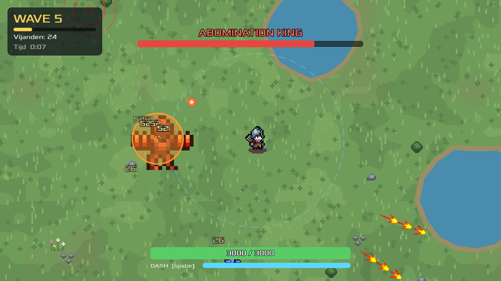
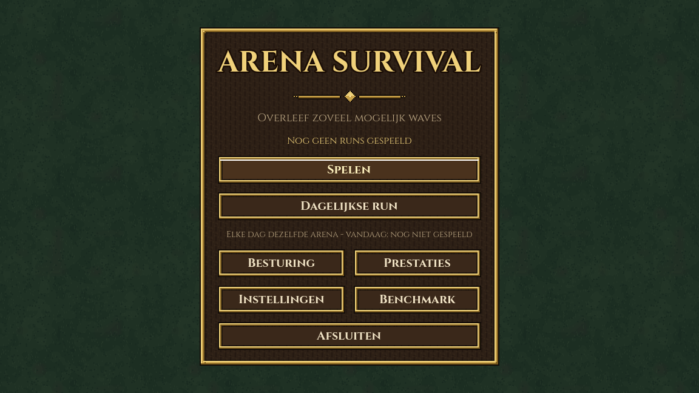
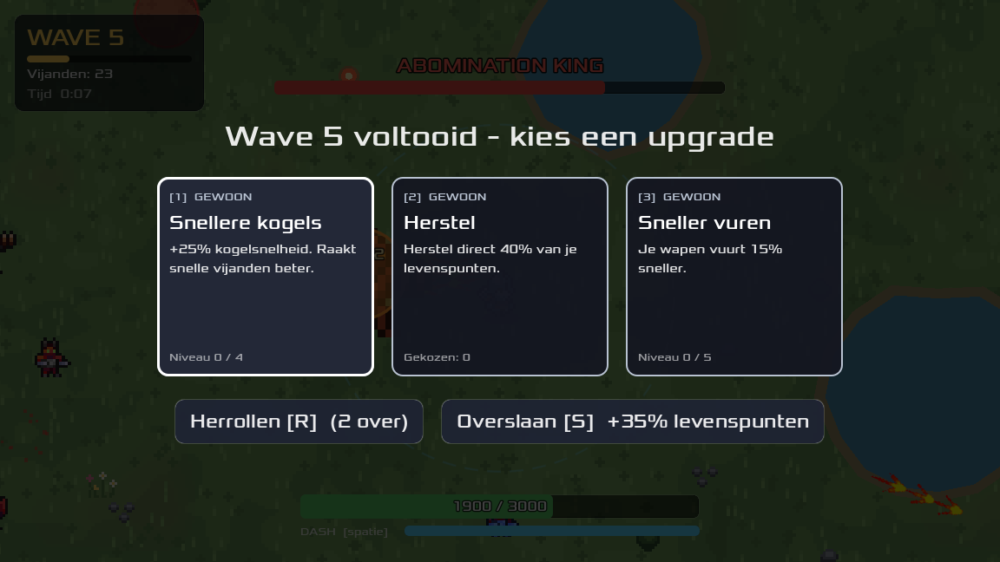
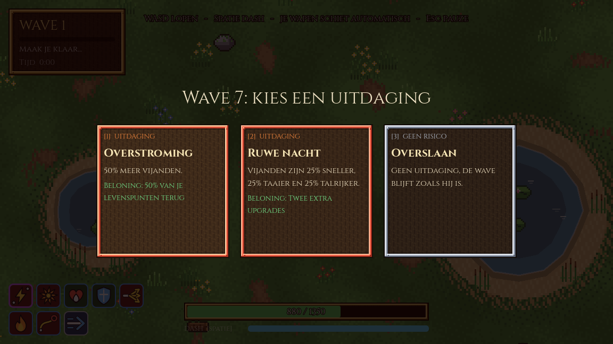
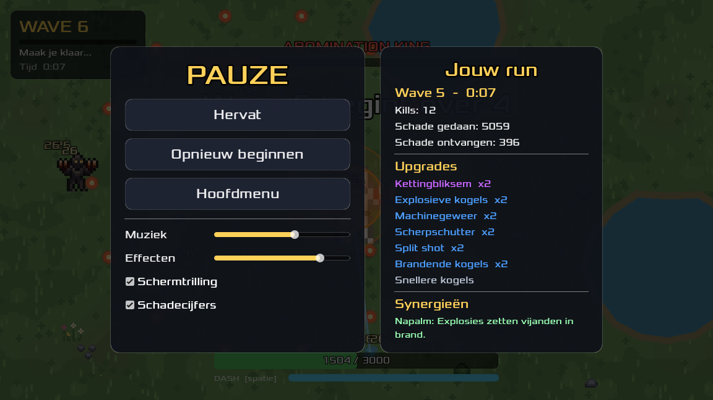

# Arena Survival

Een 2D top-down arena survival game, gemaakt in **Godot 4** als opdracht voor
*Technische Specialisatie* (SD3A, Graafschap College).

Je loopt rond in een kleine arena. Je wapen schiet automatisch op de dichtstbijzijnde vijand.
Vijanden komen in waves, en na elke wave kies je een upgrade. Hoe langer je overleeft, hoe
zwaarder het wordt. Wordt je geraakt en zijn je levenspunten op, dan begin je een nieuwe run.

**Maker:** Niels Hoekzema  |  **Verdiepingsonderwerp:** object pooling en performance-optimalisatie

## Spelen

### [Download Arena Survival v1.0 voor Windows](https://github.com/NielsHoekzema07/arena-survival-release/releases/latest)

1. Klik op de link hierboven en download onder **Assets** het bestand `ArenaSurvival-v1.0-windows-x64.zip`.
2. Pak het zip-bestand uit.
3. Start `ArenaSurvival.exe`. Installeren is niet nodig.

Windows kan een waarschuwing tonen omdat het programma niet digitaal ondertekend is. Kies dan
**Meer info** en daarna **Toch uitvoeren**.

*English:* download the zip from the [latest release](https://github.com/NielsHoekzema07/arena-survival-release/releases/latest),
extract it and run `ArenaSurvival.exe`. If Windows shows a warning, click "More info" and then "Run anyway".

Het spel is getest op Windows 11 (64-bit) met Godot 4.7.2.

## Besturing

| Toets | Actie |
|---|---|
| W A S D | Lopen |
| Spatie of Shift | Dash: een korte sprint waarbij je onkwetsbaar bent |
| 1 2 3 | Een upgrade of uitdaging kiezen |
| R | Upgrades opnieuw trekken (twee keer per run) |
| S | Een upgrade overslaan voor herstel |
| Esc | Pauzeren |
| F3 | Prestatie-overlay (FPS, frametijd, aantal objecten) |

Je wapen schiet vanzelf. Je hoeft alleen te bewegen, te dashen en slimme upgrades te kiezen.

## Wat zit erin

- **Waves** met oplopende moeilijkheid. Na elke wave kies je één van drie **upgrades**, en soms
  een **uitdaging** voor een beloning.
- **35 upgrades** in drie zeldzaamheden (gewoon, zeldzaam en episch), met kogeleffecten zoals
  split shot, ricochet, explosies, kettingbliksem, vuur, gif en bevriezing, en risicovolle
  duivelsdeals.
- **Synergieën:** bepaalde combinaties van upgrades versterken elkaar.
- **Vijanden** die rennen, schieten, splitsen of een schild hebben, **elites** en **eindbazen**
  elke vijfde wave.
- **Pickups** voor herstel en tijdelijke snelheid.
- Een **hoofdmenu**, pauzescherm, records en instellingen, en een **benchmark** voor het
  pooling-onderzoek.

| Hoofdmenu | Upgrade kiezen |
|---|---|
|  |  |

| Uitdaging kiezen | Pauzescherm |
|---|---|
|  |  |

## Documentatie

Ontwerp van het spel:

  - [Vijanden en balans](docs/ontwerp/vijandtypes.md)
  - [Waves](docs/ontwerp/waves.md)
  - [Upgrades](docs/ontwerp/upgrades.md)
  - [Collision layers](docs/ontwerp/collision-layers.md)

Onderzoek (verdieping):

  - [Object pooling: onderzoek en conclusie](docs/onderzoek/onderzoek-object-pooling.md): gemeten wat pooling oplevert, met tabellen, grafieken en de onderbouwde keuze
  - [Bevindingen over vijanden](docs/onderzoek/pooling-bevindingen.md): waarom hergebruikte vijanden trager zijn

Hoe het project is verlopen:

  - [Plan van Aanpak](docs/proces/plan-van-aanpak.docx)
  - [Logboek](docs/proces/logboek.md): per week wat er gedaan is, welke problemen er waren en hoe ze zijn opgelost
  - [Later-lijst](docs/proces/later-lijst.md): ideeën die bewust niet zijn gebouwd, met de reden
  - [Upgrade-ideeën](docs/proces/upgrade-ideen.md): de keuzelijst waaruit de upgrades zijn gekozen

## Over de broncode

De broncode van het spel staat niet in deze repository. Dit is de repository voor de
opgeleverde versies en de documentatie.

## Credits

Gemaakt met [Godot Engine](https://godotengine.org) (MIT-licentie).

**Muziek:** *House In a Forest Loop* door HorrorPen (2012), gebruikt onder de licentie
[CC BY 3.0](https://creativecommons.org/licenses/by/3.0/). Bron:
[OpenGameArt](https://opengameart.org/content/loop-house-in-a-forest).

**Pixelart:** alle afbeeldingen (speler, vijanden, projectiel, gras, decoratie en de iconen van de upgrades) zijn zelf gemaakt.

**Lettertype:** *Xolonium* door Severin Meyer, SIL Open Font License 1.1.

**Geluidseffecten:** zelf gegenereerd.

## Licentie

Alle rechten voorbehouden, zie [LICENSE](LICENSE).
