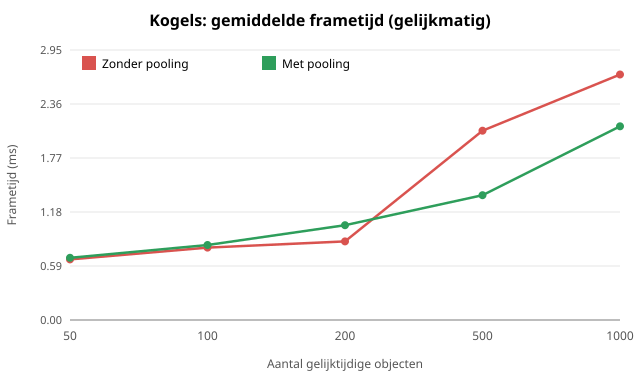
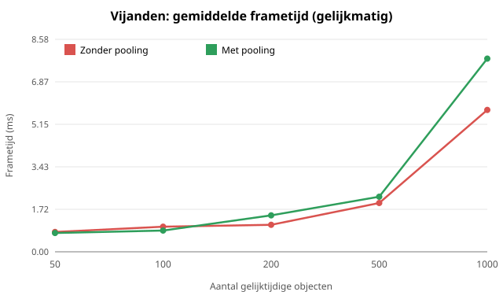

# Onderzoek: object pooling in Godot

> Let op: dit is de kopie in de release-repo. Verwijzingen naar `scenes/`, `scripts/` en `tools/` gaan over de broncode, die niet in deze repository staat. De metingen en grafieken staan wel hier.

Verdieping bij Technische Specialisatie (SD3A). Gemeten in de eigen game, Arena Survival
(Godot 4.7.2, GDScript, GL Compatibility).

## 1. Onderzoeksvraag

> In hoeverre verbetert object pooling de prestaties (frametijd en pieken) van een 2D-game in
> Godot, en geldt dat voor alle soorten objecten?

Deelvragen:

1. Helpt pooling bij kogels (`Area2D`, licht)?
2. Helpt pooling bij vijanden (`CharacterBody2D` met AI, animatie en botsing, zwaar)?
3. Verandert het antwoord als objecten in golven verschijnen in plaats van gelijkmatig?

## 2. Wat is object pooling?

Normaal maakt de game een object aan (`instantiate()` + `add_child()`) en verwijdert het weer
(`queue_free()`). Bij pooling wordt het object niet weggegooid maar uitgezet en in een lijst bewaard;
bij de volgende keer wordt het hergebruikt. De verwachte winst: minder aanmaken en opruimen en dus
minder pieken. De verwachte kosten: uitgezette objecten blijven in het geheugen en moeten netjes
worden teruggezet (`reset`).

In de game doet `PoolManager` (`scripts/pooling/pool_manager.gd`) dit voor beide varianten via
dezelfde code: `neem(scene, ouder, instelling)` en `geef_terug(node)`. Zonder pooling maakt
`neem()` een nieuw object en ruimt `geef_terug()` het op met `queue_free()`. Zo verschilt alleen het
hergebruik tussen de varianten en niets anders.

## 3. Methode

| Onderdeel | Waarde |
|---|---|
| Processor | Intel Core i7-12700H (laptop) |
| Videokaart | NVIDIA GeForce RTX 3060 Laptop GPU |
| Werkgeheugen | 16 GB |
| Besturingssysteem | Windows 11 |
| Godot | 4.7.2-stable, release-export (`build/ArenaSurvival.exe`) |
| Renderer | GL Compatibility |

- **Benchmark in de game** (`scenes/benchmark/`): N objecten tegelijk levend, levensduur 2 s.
  Sterft er een, dan komt er direct een nieuwe voor in de plaats (gelijkmatig) of alles in één keer
  (golven). Het venster is 640x360 en vsync staat uit.
- **Aantallen:** 50, 100, 200, 500 en 1000 objecten bij gelijkmatig; 200 en 1000 bij golven.
- **Herhalingen:** 3 per meetpunt (6 voor kogels bij 200, 500 en 1000, zie 4.1), 30 s per run waarvan 5 s opwarmen. Elke run is een eigen
  Godot-proces. De volgorde wisselt (met, zonder, zonder, met, ...) zodat een warmer wordende laptop
  niet steeds dezelfde variant raakt.
- **Hoofdmeting: frametijd in ms** (de `delta` per frame), niet FPS. Naast het gemiddelde worden
  p99 en de hoogste frametijd bewaard, omdat hapering in pieken zit en niet in het gemiddelde.
- Ruwe data: [pooling-alles.csv](data/pooling-alles.csv) (102 runs; samengevoegd uit
  [pooling-resultaten.csv](data/pooling-resultaten.csv) en [pooling-golven.csv](data/pooling-golven.csv) en
  [pooling-kogels-extra.csv](data/pooling-kogels-extra.csv)).
  Alle tabellen staan in [pooling-tabellen.md](data/pooling-tabellen.md), gemaakt met
  `tools/verwerk_pooling.py`. De meting is te herhalen met `meet_pooling.bat`.
- Tijdens het meten werd de laptop verder niet gebruikt.

## 4. Resultaten

### 4.1 Kogels, gelijkmatig



Bij 200, 500 en 1000 kogels is de meting herhaald tot 6 herhalingen, omdat één run zonder pooling
(herhaling 2, 6,9 ms bij zowel 500 als 1000 kogels) een uitschieter was. Dat een run met 500 en met
1000 objecten dezelfde frametijd heeft wijst op een storing buiten de game, niet op pooling. Daarom
staat hieronder naast het gemiddelde ook de **mediaan**, die zo'n uitschieter negeert.

| Aantal | Herh. | Gem. zonder (ms) | Gem. met (ms) | Mediaan zonder | Mediaan met | Verschil mediaan |
|---:|---:|---:|---:|---:|---:|---:|
| 50 | 3 | 0,663 | 0,680 | 0,681 | 0,658 | -3% |
| 100 | 3 | 0,792 | 0,820 | 0,784 | 0,838 | +7% |
| 200 | 6 | 0,860 | 1,037 | 0,843 | 1,006 | +19% |
| 500 | 6 | 2,072 | 1,366 | 1,108 | 1,345 | +21% |
| 1000 | 6 | 2,686 | 2,119 | 1,781 | 2,229 | +25% |

Het gemiddelde zonder pooling (2,07 en 2,69 ms) wordt omhoog getrokken door de uitschieter; de
mediaan laat zien dat zonder pooling in de meeste runs sneller is. In de drie extra herhalingen (4 tot
6) is dat ook zo: bij 1000 kogels 1,6 - 1,8 ms zonder pooling tegen 2,1 - 2,4 ms met pooling.
In de pieken (p99 en maximum) is er geen duidelijk verschil.

Dit is anders dan de eerste proefmetingen in de debug-build (1000 kogels: 1,88 ms zonder en 1,47 ms
met pooling, zie [pooling-bevindingen.md](pooling-bevindingen.md)). Een release-export is dus niet
automatisch gunstiger voor pooling; het verschil per run is groter dan het effect dat ik zoek.

### 4.2 Vijanden, gelijkmatig



| Aantal | Gem. zonder (ms) | Gem. met (ms) | Verschil | p99 zonder | p99 met |
|---:|---:|---:|---:|---:|---:|
| 50 | 0,802 | 0,761 | -5% | 1,67 | 1,39 |
| 100 | 1,013 | 0,860 | -15% | 1,94 | 1,39 |
| 200 | 1,090 | 1,473 | +35% | 1,79 | 2,41 |
| 500 | 1,970 | 2,227 | +13% | 2,25 | 3,55 |
| 1000 | 5,734 | 7,804 | +36% | 8,72 | 13,68 |

Let op bij 200 vijanden: het gemiddelde met pooling (1,47 ms, +35%) wordt omhoog getrokken door één
trage run (2,26 ms; de andere twee zijn 1,04 en 1,11). Op de mediaan zijn beide varianten bij 200
gelijk (1,11 tegen 1,08 ms). Het echte beeld, op de mediaan van 3 herhalingen:

| Aantal | Mediaan zonder (ms) | Mediaan met (ms) | Verschil |
|---:|---:|---:|---:|
| 50 | 0,78 | 0,72 | -8% |
| 100 | 0,91 | 0,84 | -8% |
| 200 | 1,08 | 1,11 | +3% |
| 500 | 1,95 | 2,31 | +18% |
| 1000 | 5,76 | 7,91 | +37% |

Pooling is dus pas vanaf ongeveer 500 vijanden trager, en bij 1000 duidelijk (+37%, ook in p99). De
spreiding tussen de herhalingen is bij 1000 klein (zonder 5,5 - 6,0 ms, met 7,2 - 8,3 ms), dus dit
effect is betrouwbaar. Bij lage aantallen (50 en 100) is pooling licht gunstig, maar dat verschil
valt binnen de spreiding.

### 4.3 Golven

Bij golven (200 en 1000 objecten, 3 herhalingen):

| Type | Aantal | Gem. zonder | Gem. met | Verschil | Max zonder | Max met |
|---|---:|---:|---:|---:|---:|---:|
| Kogels | 200 | 0,761 | 0,713 | -6% | 7,1 | 4,4 |
| Kogels | 1000 | 1,195 | 1,167 | -2% | 41,0 | 14,1 |
| Vijanden | 200 | 1,241 | 1,136 | -8% | 11,4 | 12,9 |
| Vijanden | 1000 | 5,237 | 7,328 | +40% | 52,6 | 37,6 |

Grafieken: [kogels](afbeeldingen/pooling_kogels_golven_frametijd.svg),
[vijanden](afbeeldingen/pooling_vijanden_golven_frametijd.svg) (ook p99, maximum en onderhoudstijd
staan in `afbeeldingen/`).

- Bij kogels is het gemiddelde vrijwel gelijk. Het verschil zit in de uitschieters: bij 1000 kogels is
  de zwaarste frame 14 ms met pooling tegen 41 ms zonder.
- Bij vijanden is pooling bij 1000 weer ongeveer 40% trager op het gemiddelde.

### 4.4 Wat pooling wel bespaart: aanmaken en opruimen

De tijd die per frame opgaat aan aanmaken en opruimen (`gem_onderhoud_ms`) is met pooling bijna
altijd lager, vooral bij kogels:

| Aantal | Kogels zonder | Kogels met | Vijanden zonder | Vijanden met |
|---:|---:|---:|---:|---:|
| 200 | 0,0151 | 0,0079 | 0,0175 | 0,0200 |
| 500 | 0,0695 | 0,0183 | 0,0548 | 0,0434 |
| 1000 | 0,1196 | 0,0403 | 0,1767 | 0,1262 |

(ms per frame). Met pooling worden er 0 objecten nieuw aangemaakt en worden er duizenden
hergebruikt. Het aanmaken is dus echt goedkoper met pooling, ook bij vijanden. Alleen is dat
voordeel bij vijanden (circa 0,05 ms per frame) veel kleiner dan de extra kosten in de physics
(circa 2,8 ms per frame bij 1000 vijanden: 9,0 ms zonder en 11,9 ms met pooling).

## 5. Analyse

1. **Pooling is geen vaste winst.** Het bespaart aanmaakkosten, maar dat levert alleen netto winst op
   als die kosten groot zijn ten opzichte van de rest van het werk per object.
2. **Kogels:** het aanmaken is licht en de besparing is klein (4.4). In de gelijkmatige meting is
   pooling bij 200 tot 1000 kogels op de mediaan 19 tot 25% trager, niet sneller (4.1). Bij golven is
   het gemiddelde gelijk en zijn de pieken met pooling lager (4.3). Een duidelijk voordeel van
   pooling voor kogels kan ik in deze meting dus niet aantonen.
3. **Vijanden:** pooling is trager. De winst op aanmaken is klein en de `CharacterBody2D` van een
   hergebruikt object kost meer physics-tijd. Dat heb ik uitgezocht in
   [pooling-bevindingen.md](pooling-bevindingen.md): `move_and_slide()` kost per aanroep 5,2 - 5,5
   microseconden bij hergebruikte vijanden tegen 3,7 - 3,9 bij nieuwe. Meerdere oorzaken zijn
   uitgesloten (`process_mode`, uit de boom halen, botsingslaag en -mask, straal, animatie). De
   oorzaak zelf is niet bewezen; mijn hypothese is dat het in de toestand van het lichaam in de
   physics-server van Godot zit.
4. **Patroon:** bij golven (waarbij veel objecten tegelijk verdwijnen en verschijnen) lijkt pooling
   vooral pieken af te vlakken, maar dat zijn maar twee aantallen. Het is een vermoeden, geen
   conclusie.

## 6. Conclusie

- Voor **kogels** levert pooling in deze meting geen aantoonbare winst op: het scheelt weinig aan
  aanmaakkosten, de mediaan frametijd is bij gelijkmatig spawnen iets slechter en alleen bij golven
  zie ik lagere pieken. De kosten zijn klein, dus het is geen slechte keuze, maar ook geen bewezen
  verbetering.
- Voor **vijanden** is pooling in deze game slechter: bij 500 of meer vijanden stijgt de frametijd
  met 18 tot 40%.
- Het antwoord op de onderzoeksvraag is dus: **pooling is geen automatische verbetering**. In deze
  game levert het bij kogels weinig of niets op en schaadt het bij vijanden (zware objecten met een
  fysiek lichaam).
- **Besluit in de game:** noch kogels, noch vijanden gaan via de pool (`Weapon.pool_kogels = false`,
  `EnemySpawner.pool_vijanden = false`). De pool zelf (`PoolManager`) blijft in het project en staat
  met één vinkje aan; de benchmark gebruikt hem om beide varianten te vergelijken.

### Waarom ik hiervoor heb gekozen en hoe ik daarop kwam

Het doel was de variant te kiezen die de beste prestaties geeft. Dat heb ik in vier stappen
bepaald, en ik heb mijn eerdere keuze onderweg bijgesteld.

1. **Eerste keuze (kogels wel, vijanden niet).** Mijn proefmetingen in de debug-build gaven bij
   kogels een voordeel (1000 kogels: 1,88 ms zonder pool, 1,47 ms met pool) en bij vijanden een
   nadeel. Daarop koos ik: kogels poolen, vijanden niet.
2. **De meetreeks in de release-export (3 herhalingen) leek dat te bevestigen.** Het gemiddelde bij
   500 en 1000 kogels was 46 tot 59% lager met pool. Maar de herhalingen lagen ver uit elkaar
   (zonder pool 1,1 tot 6,9 ms). Eén run (herhaling 2) was precies 6,9 ms bij zowel 500 als 1000
   kogels, wat niet past bij een effect van het aantal kogels.
3. **Daarom heb ik de kogelmeting herhaald (6 herhalingen).** In de drie nieuwe herhalingen was
   zonder pool juist sneller. Met de mediaan, die zo'n uitschieter negeert, is pooling bij 200,
   500 en 1000 kogels 19, 21 en 25% trager. Onder 200 kogels is er geen verschil. Het voordeel
   uit stap 2 kwam dus door één verstoorde run en uit de debug-build, niet door pooling.
4. **Dat levert de keuze op:** zonder pool is voor kogels even snel of sneller, en voor vijanden
   (vanaf ongeveer 500) duidelijk sneller. Pooling heeft ook een prijs in de code: objecten moeten
   netjes worden teruggezet (`reset`), er is een extra pool om te beheren, en vergeten
   terug te zetten geeft fouten die moeilijk te vinden zijn (ik heb er een paar gehad, zie het
   logboek). Als pooling geen prestatie oplevert, is dat risico niet te verantwoorden.

Een tegenargument is dat pooling bij golven de zwaarste frames verlaagt (1000 kogels: 14 ms tegen
41 ms). Dat weegt hier niet zwaar genoeg: het is één enkele meting met 3 herhalingen, en het
speelt pas bij 1000 kogels tegelijk. Dat aantal komt in de game niet voor; je schiet maar een paar
kogels per seconde met een bereik van 200 pixels.

**Wat deze keuze niet zegt:** dat object pooling nooit nuttig is. Het zegt dat het voor deze game, op
deze machine en in Godot 4.7.2, geen betere prestaties geeft dan gewoon aanmaken en opruimen.
Dat is zelf een resultaat van het onderzoek.

## 7. Beperkingen

- Eén machine (een laptop met 3 herhalingen per punt); één Godot-versie.
- Een uitschieter bij kogels zonder pooling (zie 4.1); daarom zijn die punten tot 6 herhalingen
  uitgebreid en is de mediaan erbij gezet. De run-tot-run spreiding is bij kogels groot.
- Golven zijn alleen bij 200 en 1000 objecten gemeten.
- De meetwaarde voor geheugen (`geheugen_mb`) is in de CSV 0 en dus niet bruikbaar; geheugengebruik
  is daarom niet vergeleken.
- Het onderzoek is gedaan in een synthetische benchmark, niet tijdens echt spelen. In de echte game
  is het aantal objecten meestal veel lager dan 1000.
- De oorzaak van de tragere hergebruikte vijanden is niet bewezen.

## 8. Zelf herhalen

Via `meet_pooling.bat` (of het benchmarkmenu in de game) en daarna:

```
py tools/verwerk_pooling.py data/pooling-alles.csv
```

## 9. Bronnen

- Eigen metingen en code in deze repository (zie hierboven).
- Godot Docs, *CPU optimization*: https://docs.godotengine.org/en/stable/tutorials/performance/cpu_optimization.html
- Godot Docs, *General optimization tips*: https://docs.godotengine.org/en/stable/tutorials/performance/general_optimization.html
- *Object Pooling vs Instantiate in Godot 4: when it actually matters* (DEV Community): https://dev.to/saltmire/object-pooling-vs-instantiate-in-godot-4-when-it-actually-matters-h9k
- *The Complete Guide to Object Pooling, Killing Stutter in Godot Through Reuse*: https://uhiyama-lab.com/en/notes/godot/godot-object-pooling-basics/
- Godot Forum, *How do you decide when a mobile game needs object pooling in Godot?*: https://forum.godotengine.org/t/how-do-you-decide-when-a-mobile-game-needs-object-pooling-in-godot/142731

(De bronnen zijn gevonden met een zoekopdracht; lees ze zelf door voordat je ze definitief opneemt.)
